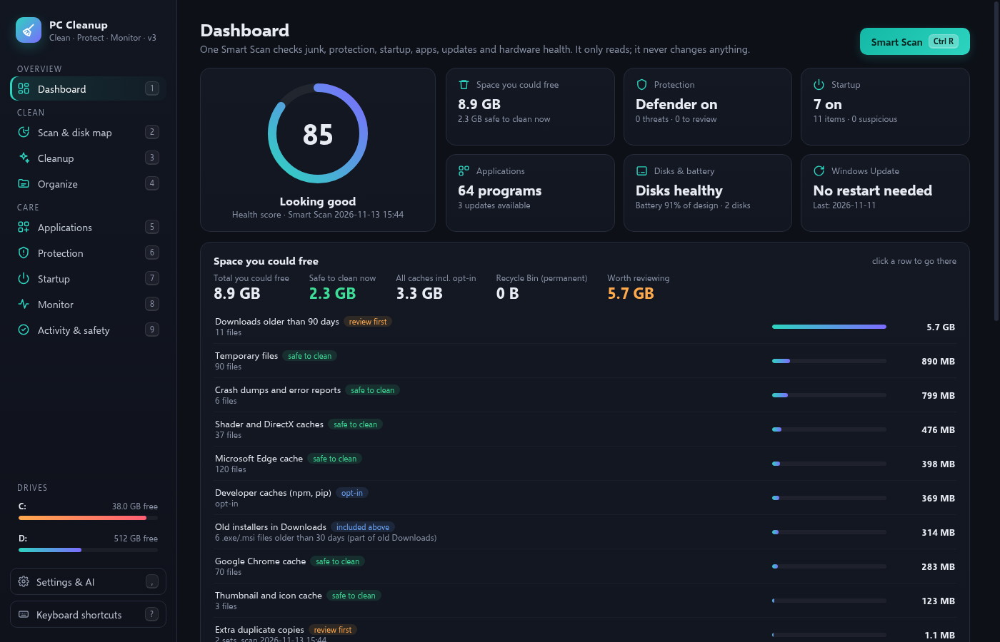
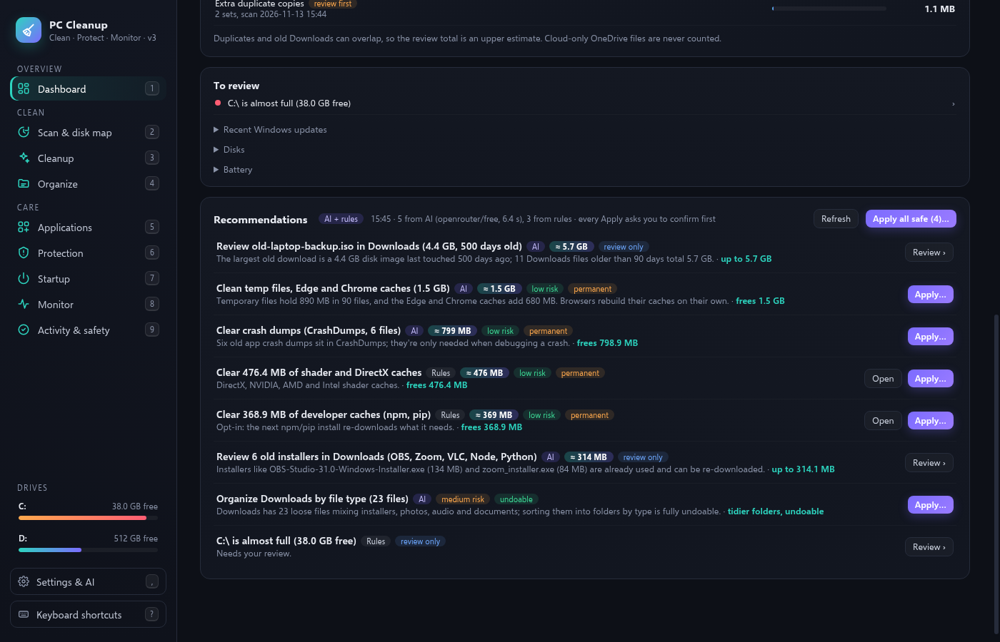
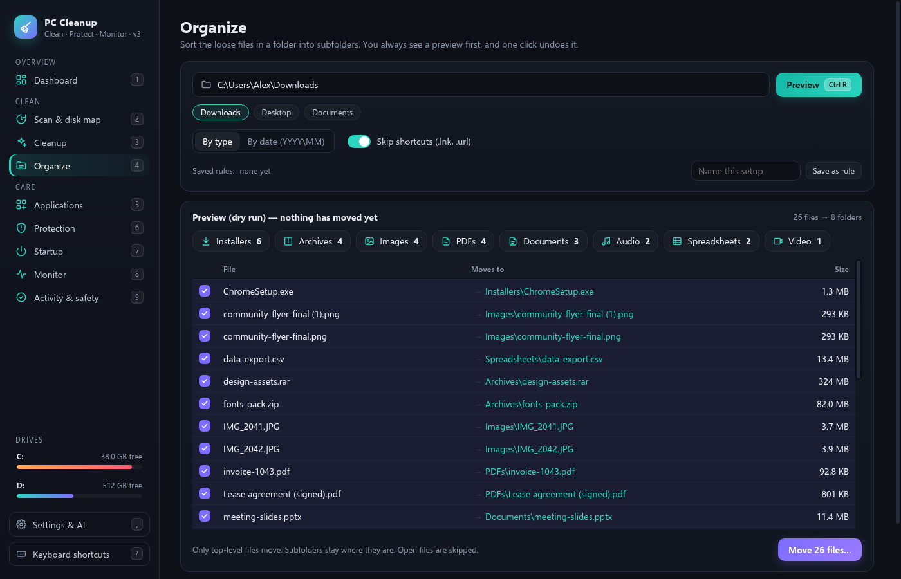

# PC Cleanup & Organizer

A local Windows app for cleanup, organization, protection, startup, uninstall and system monitoring.

[](https://github.com/asjames18/pc-cleanup-organizer/releases/latest)


[](LICENSE)

## Overview

PC Cleanup & Organizer runs a private HTTP server on `127.0.0.1` (default port `48251`) and opens in its own Microsoft Edge window (or the system browser if Edge is not available). It uses the Python standard library only; no pip packages are required.

Scans are read-only. Nothing is deleted or moved until you confirm the action in the app.

## Key features

- **Dashboard / Smart Scan** — A read-only overview of disk space, cleanup categories, downloads, startup items, protection status and health information, with a health score and optional recommendations.
- **Scan & disk map** — Walk a folder (read-only) to see a disk map, largest files, duplicate groups (hashed above a size threshold) and old files in Downloads.
- **Cleanup** — Measure and, after confirmation, remove selected temp and cache categories (user TEMP, browser caches, crash dumps, and optional shader, thumbnail, log and developer caches). Browser cleanup touches cache folders only. Some Windows Update and NVIDIA installer locations are measured for review but are never cleaned by this app.
- **Organize** — Preview, then move top-level files in a folder into subfolders by type or by date (`YYYY\MM`). Shortcuts can be skipped. Undo puts every moved file back.
- **Applications** — Installed programs, Microsoft Store apps, uninstall with leftover-folder review, an orphan-folder scan (review-only) and optional upgrades through winget.
- **Protection** — A read-only check of Microsoft Defender / Security Center status, browser extensions, home pages and search settings, the hosts file, proxy settings and notable startup or scheduled-task items. You can start a Defender Quick Scan from the app.
- **Startup** — Review and toggle startup items (and, where allowed, scheduled tasks). Items can be switched back on; nothing is deleted here.
- **Monitor** — Live CPU, memory, disk, network and (when NVIDIA tools are available) GPU usage, plus a process list. Monitoring runs only while the Monitor view is being watched. Ending a process requires an explicit action and refuses protected Windows processes.
- **Activity & safety** — A local log of actions taken in the app.
- **Recommendations (optional, off by default)** — Built-in rules with no network, or an OpenAI-compatible provider such as OpenRouter, LM Studio or Ollama. Suggestions are allowlisted and re-validated on the server. The recommender never proposes emptying the Recycle Bin or sending raw file lists to recycle. Every apply step still requires confirmation.
- **Admin relaunch** — Some Windows locations need elevation. The app can request a UAC prompt; it never elevates automatically.

## Screenshots



| Recommendations | Organize preview |
| --- | --- |
|  |  |

## Download

The installer is the supported way to install PC Cleanup & Organizer:

- [Latest GitHub release](https://github.com/asjames18/pc-cleanup-organizer/releases/latest) — `PCCleanup-Setup-3.1.0.zip`
- [melanatedintech.com/apps](https://melanatedintech.com/apps)

Current release: **3.1.0**. The zip is 176 KB. Tested on Windows 11.

## Install

1. Download `PCCleanup-Setup-3.1.0.zip` and open it.
2. Double-click `Install-PCCleanup.cmd`. If you run it from inside the zip, it unpacks itself first. Extracting the zip first also works.
3. If Windows SmartScreen says "Windows protected your PC", click **More info**, then **Run anyway**. The installer is not code-signed.
4. The app needs Python 3.10 or newer and no extra packages. If Python is missing, the installer can install Python 3.13.17 for your account from python.org (the download's SHA-256 and signature are checked; no administrator account is required). There is no Whisper model and no pip install step.
5. It copies the app to `%LOCALAPPDATA%\PCCleanup\app`, keeps your settings, logs, undo history and registry backups in `%LOCALAPPDATA%\PCCleanup\data`, adds Desktop and Start menu shortcuts (`Ctrl+Alt+C`) and opens the app.

The app itself is small; a typical install finishes in about a minute, plus about a minute if Python has to be installed. Running the installer again is safe (repair or upgrade; your data is kept). If you are offline and Python is already present, nothing else needs to be downloaded. If a Python download fails, the installer stops safely.

A longer end-user guide ships in the zip as `README.md` (the same text as [`packaging/README.md`](packaging/README.md) in this repository). Some actions, such as uninstalling programs installed for all users, show Windows' own administrator prompt.

To uninstall, double-click `Uninstall-PCCleanup.cmd` or use **Start menu > Uninstall PC Cleanup & Organizer**. Your settings and logs are kept unless you choose to delete them. Python stays installed.

## Verify the SHA-256

The SHA-256 of `PCCleanup-Setup-3.1.0.zip` is:

```
19546a298fa43168f65a7252e05fd7730086478a2aa71b11982bb1692a0b7157
```

On Windows, open Command Prompt in the folder that contains the zip and run:

```bat
certutil -hashfile PCCleanup-Setup-3.1.0.zip SHA256
```

The hash should match the value above and the `PCCleanup-Setup-3.1.0.zip.sha256` file attached to the [release](https://github.com/asjames18/pc-cleanup-organizer/releases/latest). If it does not match, do not run the installer.

## System requirements

- Windows 10 or 11 (64-bit)
- Python 3.10 or newer (standard library only; the installer can install 3.13.17 if needed)
- Microsoft Edge, or another system browser as a fallback
- winget / App Installer (optional), for the application-update list and upgrades
- NVIDIA drivers and `nvidia-smi` (optional), for GPU figures on the Monitor view

No pip packages and no Whisper model are required.

## How to use it

1. Start PC Cleanup & Organizer from the Desktop or Start menu shortcut. The Dashboard is the first view.
2. Run a Smart Scan or open **Scan & disk map** to inspect a folder. Scanning does not change files.
3. On **Cleanup**, measure categories, review what would be removed, then confirm. Use a dry run first if you want a preview. Emptying the Recycle Bin requires typing `EMPTY`.
4. On **Organize**, choose a folder and a rule, preview the plan, then confirm. Use Undo (or `Ctrl+Z` on that tab) to restore the last organize operation.
5. Review **Applications**, **Protection** and **Startup** before changing anything. Uninstalls, leftover removal, winget upgrades and startup toggles are explicit, confirmed actions.
6. Optionally turn on recommendations in **Settings & AI** and review each suggested action before applying it.
7. Press `?` in the app for keyboard shortcuts. Number keys `1`–`9` switch the main views.

## Privacy

PC Cleanup & Organizer is local-first.

- The server binds to `127.0.0.1` only and rejects requests whose `Host` header is not `127.0.0.1` or `localhost` on the app port. State-changing POST requests also require a custom header, so other websites cannot trigger them.
- Settings, logs, undo history and registry backups live in `%LOCALAPPDATA%\PCCleanup\data` (or next to the app when you run from source).
- Scans are read-only. Deletes, recycles, moves, uninstalls, leftover removal, registry-key deletion, Recycle Bin emptying, process termination and startup changes all require confirmation in the app.
- Recycle and organize operations are limited to an allowlist: the user profile, Desktop, Documents, Downloads and a local test sandbox. Windows, Program Files, ProgramData, AppData, drive roots and tool or dot folders such as `.git` or `.venv` are treated as protected and are refused.
- Browser cleanup is limited to cache folders (for example Cache, Code Cache and GPUCache, or Firefox `cache2`). Cookies, history, passwords and profiles are never touched.
- Several system locations (Windows Update download cache, Delivery Optimization cache, NVIDIA installer cache) can be measured but are review-only; this app will not clean them.
- Temp and cache files that are cleaned are deleted (not recycled) and are skipped when in use. User files sent from Scan can go to the Recycle Bin, and the app refuses to recycle every copy in a duplicate group.
- Organize can be undone from the last operation. An action log is written under `logs/`.
- When recommendations use an OpenAI-compatible provider, the app sends a compact snapshot (sizes, names, ages and ids). File contents and secrets are not included. The API key is read from an environment variable (default name `OPENROUTER_API_KEY`) and is never stored in `ai-settings.json`, `settings.json` or logs. The model may only pick from a capability-filtered allowlist.
- Administrator rights are never taken automatically. Elevation uses a standard UAC prompt, and only when you ask.

## Build from source

From a clone of this repository, with Python 3.10 or newer:

```bat
pythonw cleanup.pyw
```

To build the installer zip:

```bat
python packaging\build_dist.py . dist
```

This writes `dist\PCCleanup-Setup-3.1.0.zip` and `dist\PCCleanup-Setup-3.1.0.zip.sha256`. The packager refuses to build if packed files contain API keys or personal strings.

On first run the app creates `settings.json` and `ai-settings.json`. You can copy the `*.example.json` files to those names and edit them; leave `last_scan` empty. Do not commit the live settings files. Defaults include `old_days` of 90, `dup_min_kb` of 100, and an organize rule of `type` (or `date` for `YYYY\MM` folders).

The optional environment variable `CLEANUP_PORT` changes the server port (default `48251`).

`pc_test.py` is a small local test helper. Destructive steps it performs are limited to a `test-sandbox` folder next to the app. `research/cleanmymac-notes.md` is background research from an earlier design pass.

## Troubleshooting

**SmartScreen blocks the installer.** Click **More info**, then **Run anyway**. The installer is not code-signed.

**The installer says Python is missing.** Let it install Python 3.13.17 for your account, or install Python 3.10+ from [python.org](https://www.python.org/) yourself and run the installer again.

**The window does not open.** Confirm Microsoft Edge or another browser is available. If port `48251` is already in use, set `CLEANUP_PORT` to a free port.

**Nothing was deleted after a scan.** Scans are read-only. Open the relevant view, review the plan and confirm the action.

**Organize or Recycle is refused.** Those operations are limited to the user profile, Desktop, Documents, Downloads and a local test sandbox. Protected locations are blocked on purpose.

**The application-updates list is empty.** The optional upgrades list uses winget (App Installer). The installer will tell you if it is missing.

**A cleanup or uninstall needs administrator rights.** The app never elevates automatically. Approve the Windows UAC prompt only if you asked the app to relaunch as administrator or if Windows itself is uninstalling a program installed for all users.

## License

This project is licensed under the [MIT License](LICENSE). Copyright (c) 2026 Antonio James.

The app uses the Python standard library only. Optional recommendations may call an OpenAI-compatible endpoint that you configure (OpenRouter, LM Studio or Ollama). Optional application updates use winget, if it is installed. Python itself is licensed under the [PSF License](https://docs.python.org/3/license.html).

## Made by

[Antonio James](https://antoniojames.dev) / [Melanated in Tech](https://melanatedintech.com)

- [antoniojames.dev](https://antoniojames.dev)
- [melanatedintech.com](https://melanatedintech.com)
- [github.com/asjames18](https://github.com/asjames18)
